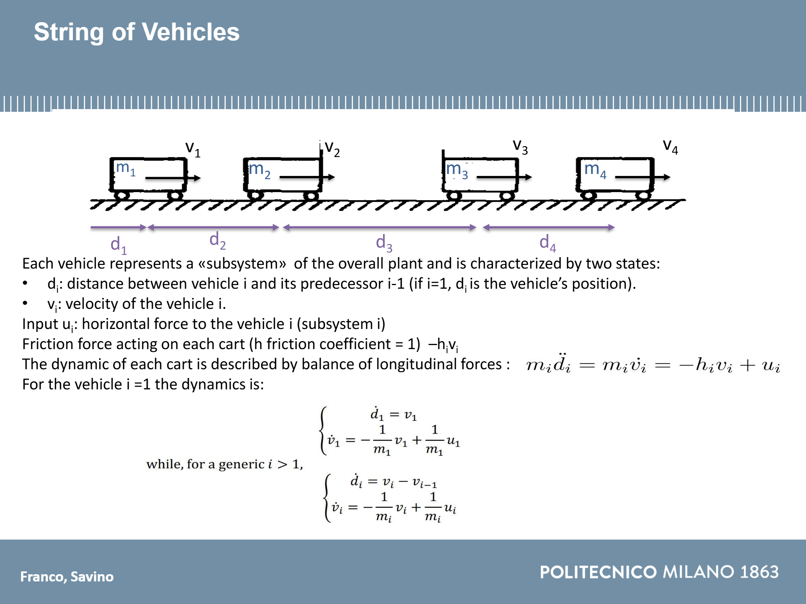
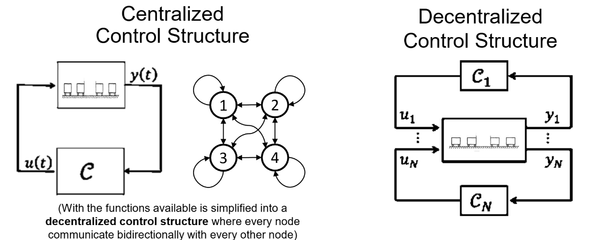

# Decentralized Networked Control of a Vehicle Platoon


MSc project · Politecnico di Milano · A. M. Franco, G. M. D. Savino

## Overview

Design and analysis of **state-feedback controllers for a platoon of 4 vehicles** under
different communication topologies. The open-loop system is unstable; each controller only
uses the states available through its communication graph. Gains are computed with **LMI
optimization** in continuous and discrete time.

<p align="center"></p>

## Key Results

- Closed-loop **asymptotic stability achieved for all information structures**, in both CT and DT
- **No fixed modes** in any of the decentralized structures
- **Comparable settling times (~10–15 s) across all schemes**: sparse topologies (star, cycle)
  match the centralized controller
- Decentralized / star-unidirectional and cycle-previous / cycle-bidirectional show near-identical
  dynamics, due to closed-loop matrices differing only in small off-diagonal terms

## System Model

- MIMO linear state-space model; states per vehicle: velocity `v_i` and inter-vehicle distance `d_i`
- Continuous-time model and discretized model for digital implementation

## Control Structures

| Structure | Information flow |
| :-- | :-- |
| Centralized | Full state available to all controllers |
| Decentralized | Local state only |
| Star | Unidirectional and bidirectional, center ↔ leaves |
| Cycle | Forward, backward and bidirectional ring |

<p align="center"></p>

## Methodology

1. Controller synthesis via **LMI** with structural constraints on the gain matrix (CT and DT)
2. Stability verification through closed-loop eigenvalues and spectral abscissa / radius
3. **Fixed-mode analysis** for each decentralized information structure
4. Time-domain simulation in **Simulink**: relative / absolute positions and speed profiles,
   CT vs DT comparison

<p align="center">
  
  
</p>

## Tech Stack

MATLAB · Simulink · YALMIP · LMI optimization · Graph theory

## Repository Structure

```
├── project_06_StringVehicles_FrancoSavino.m   # Main script: controller design, analysis, plots
├── 06_StringVehicles.m                        # Plant model (course material)
├── LMI_CT_DeDicont.m                          # LMI routine, continuous time
├── LMI_DT_DeDicont.m                          # LMI routine, discrete time
├── di_fixed_modes.m                           # Fixed-mode computation
├── CT_models.slx                              # Simulink models
├── Images/                                    # Figures
└── Project Franco_Savino.pdf                  # Project presentation
```

## Run

Run `project_06_StringVehicles_FrancoSavino.m` in MATLAB (requires Simulink and YALMIP with an
SDP solver).
